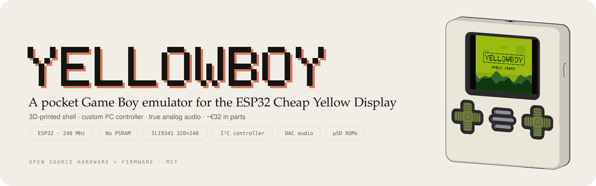
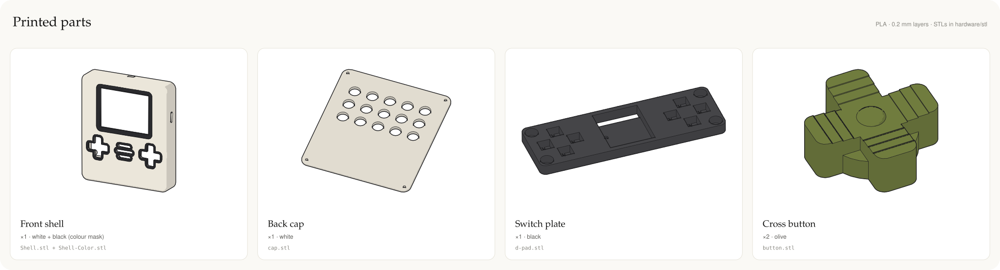
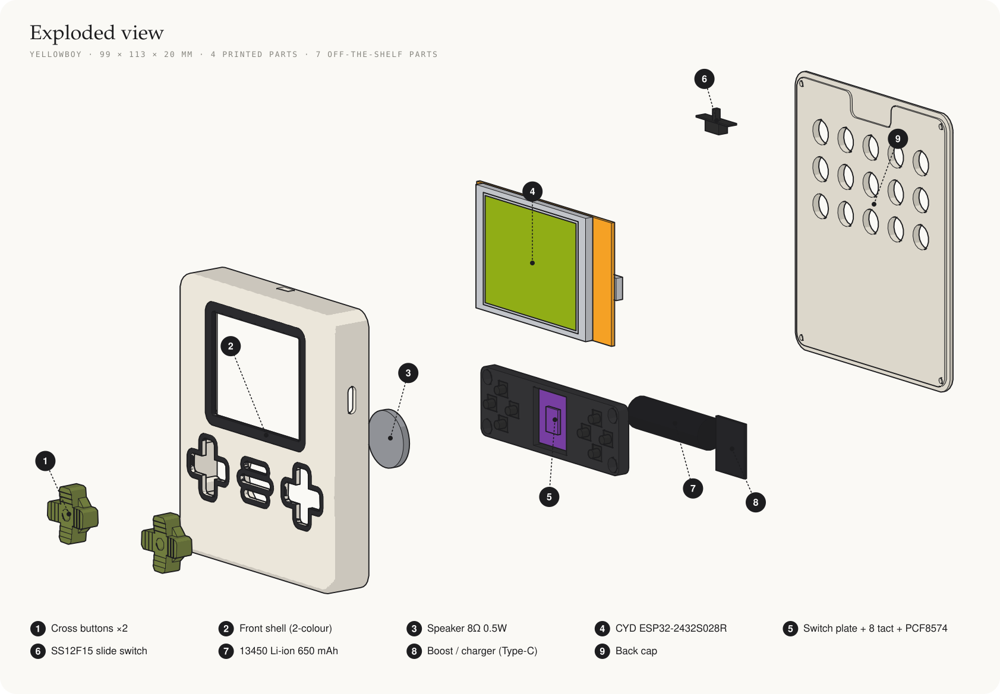
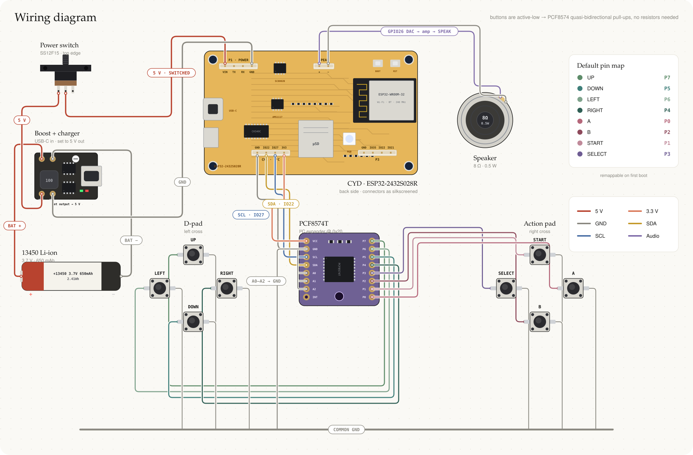
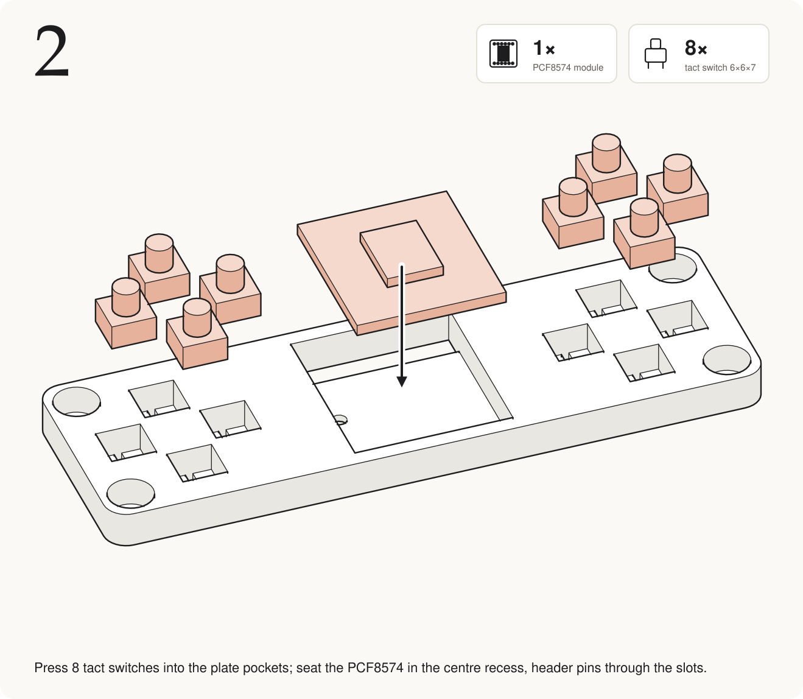
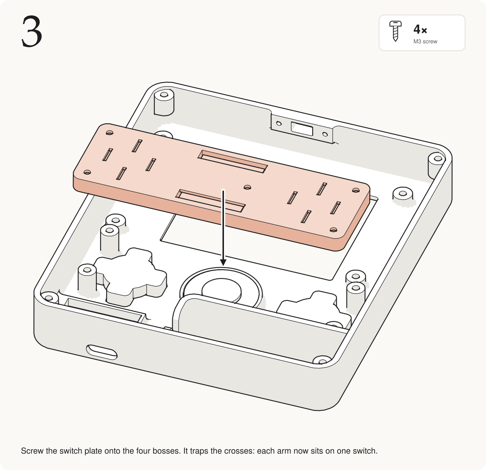
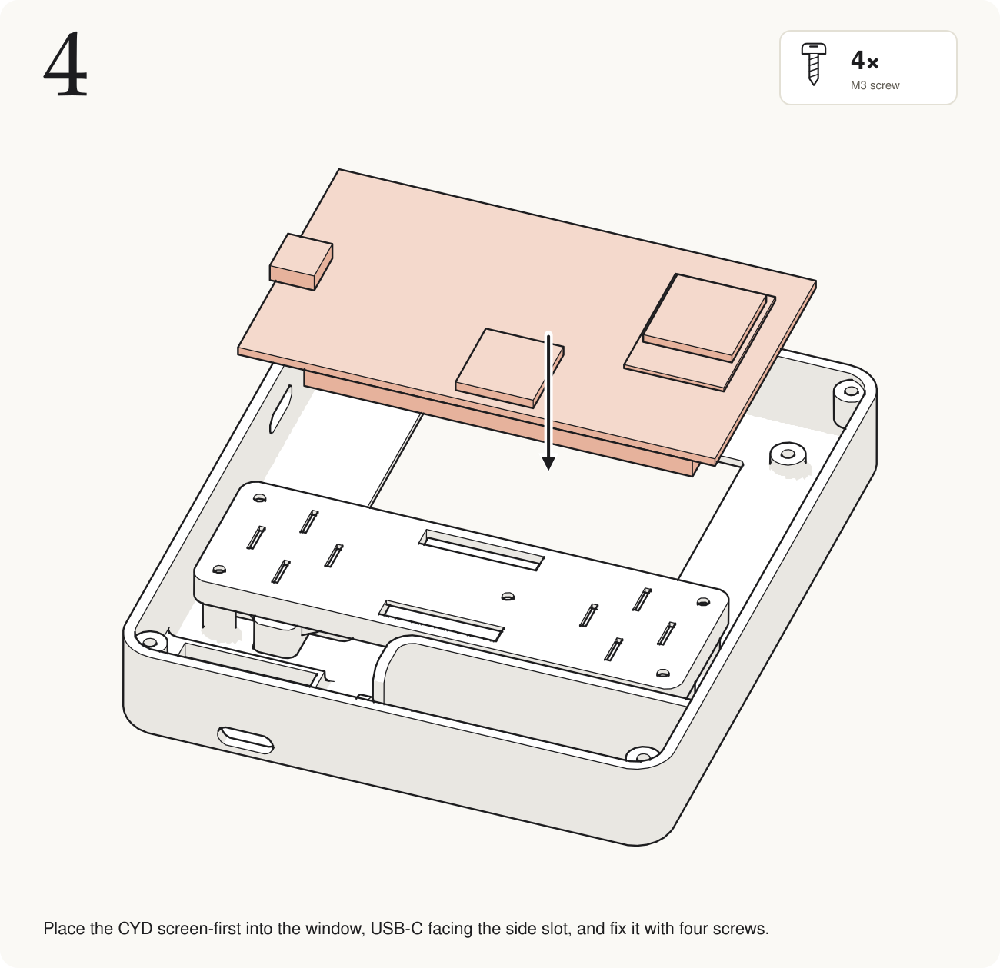
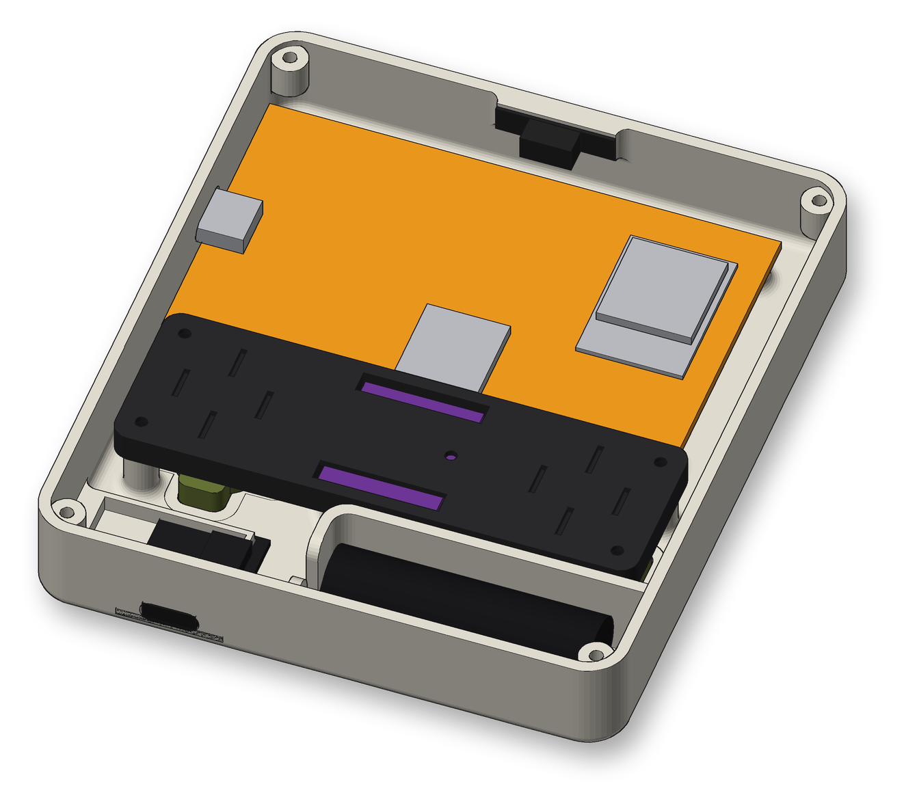
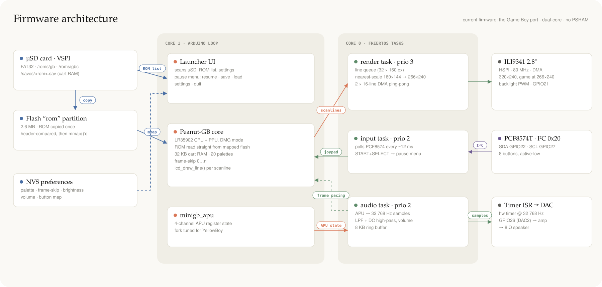

<p align="center">
  
</p>

<p align="center">
  
  
  
  
  
</p>

<p align="center">
  <a href="#hardware">Hardware</a> ·
  <a href="#printed-parts">Printed parts</a> ·
  <a href="#wiring">Wiring</a> ·
  <a href="#assembly">Assembly</a> ·
  <a href="#firmware">Firmware</a> ·
  <a href="#using-yellowboy">Using it</a>
</p>

---

**YellowBoy** is an open-source handheld that turns the €20 *ESP32 Cheap Yellow Display* (CYD) into a pocket Game Boy. It plays original Game Boy ROMs from a microSD card, reads its two cross pads through a single I²C expander, outputs sound on the ESP32's DAC, and runs from a small Li-ion cell inside a two-colour 3D-printed shell.

There is no custom PCB. It uses off-the-shelf modules, eight tact switches and some wire, and the firmware fits the ESP32's internal RAM, so no PSRAM is needed.

<p align="center">
  
  
  
</p>

> [!NOTE]
> YellowBoy is still a work in progress. A build video will be published on YouTube.

## Highlights

|  |  |
|---|---|
| **Full-speed DMG emulation** | [Peanut-GB](https://github.com/deltabeard/Peanut-GB) on core 1. Rendering, input and audio run as FreeRTOS tasks on core 0. |
| **No PSRAM** | ROMs are copied once into a 2.6 MB flash partition and memory-mapped. The CPU reads the cartridge straight from flash. |
| **Real audio** | Samples from [minigb_apu](https://github.com/YigitSalihEmecen/minigb_apu_YellowBoy) go through a low-pass and DC-blocking filter, then a 32 768 Hz timer ISR writes them to **DAC2 (GPIO26)**. There's no PWM carrier hiss. |
| **Smooth video** | Scanlines are scaled to 266 × 240 and sent to the ILI9341 over 80 MHz SPI with double-buffered DMA. |
| **Two-wire controller** | All 8 buttons go through one PCF8574 on I²C. On first boot a wizard asks you to press each button, so you can wire them in any order. |
| **Persistent everything** | Battery saves go to the SD card. Palette, frame-skip, brightness, volume and button map are kept in NVS. |
| **20 palettes** | Classic Green, Original DMG, Pocket Gray, Warm Sepia, Cool Blue, Autumn, Grayscale, Lava, Ocean, Forest, Sunset, Cherry, Ice, Chocolate, Mint, Peach, Lavender, Neon, Inverted, Gold |

---

## Hardware

<p align="center">
  
</p>

| # | Part | Qty | Notes |
|---|------|:---:|-------|
| 1 | **ESP32-2432S028R** “Cheap Yellow Display” | 1 | 2.8″ ILI9341 320×240, ESP32-WROOM-32, µSD slot, on-board speaker amp |
| 2 | **PCF8574T** I/O expander module | 1 | The purple 16-pin breakout. Tie **A0–A2 to GND** for address `0x20` |
| 3 | **Tact switch 6 × 6 × 7 mm**, 2-pin THT | 8 | 4 per cross pad |
| 4 | **Speaker 8 Ω 0.5 W, Ø 23 mm** with JST 1.25 lead | 1 | Plugs straight into the CYD `SPEAK` header |
| 5 | **3.7 V → 5 V 2 A boost + charger**, Type-C | 1 | ⚠️ This module can also output 9 V. **Set it to 5 V.** |
| 6 | **13450 Li-ion cell**, 3.7 V 650 mAh | 1 | About 2.4 Wh |
| 7 | **SS12F15 SPDT slide switch**, panel-mount | 1 | Power. Sits on the top edge |
| 8 | Hardware | – | 4 × M3 for the CYD, 4 × M3 for the switch plate, 2 small screws for the slide switch, 4 corner screws for the back cap, 28 AWG wire, heat-shrink, JST 1.25 4-pin cable |

> [!CAUTION]
> Li-ion cells can catch fire if they are shorted, punctured or over-discharged. Insulate every joint, keep the cell away from screw tips, and use a protected cell if you can.

---

## Printed parts

<p align="center">
  
</p>

All models are in [`hardware/stl`](hardware/stl). They are exported in their assembled positions, so you can drop them into one scene to check fit.

| File | Part | Qty | Colour |
|------|------|:---:|--------|
| `Shell.stl` | Front shell (face, bosses, battery cradle, switch bracket, port cut-outs) | 1 | White |
| `Shell-Color.stl` | **Paint mask only**: screen bezel, cross outlines, speaker grille | – | Black |
| `cap.stl` | Back cap | 1 | White |
| `d-pad.stl` | Switch plate. Holds the 8 tact switches and the PCF8574 | 1 | Black |
| `button.stl` | Cross button. Print it twice: one is the D-pad, one is A/B/START/SELECT | 2 | Olive |

> [!TIP]
> **Two-colour face:** `Shell-Color.stl` is not a separate part. It overlaps the shell on purpose. In Bambu Studio, OrcaSlicer or PrusaSlicer, load `Shell.stl` and add `Shell-Color.stl` to the same object as a *part* or *modifier*, then give it the second filament. The slicer paints the bezel and outlines in that colour. With a single-colour printer, skip it.

Suggested print settings: PLA, 0.2 mm layers, 3 walls, 15 % infill. Print the shell face-down so the textured face comes out clean.

---

## Exploded view

<p align="center">
  
</p>

The stack, front to back:

* the **crosses** rock on centre pivots in the face
* the **speaker** sits in the ring behind the grille
* the **CYD** goes screen-first into the window on four bosses
* the **switch plate** clamps the crosses so each arm presses one tact switch
* the **cell**, **boost module** and **slide switch** fill the bottom and top edges
* the **back cap** closes it all

<details>
<summary><b>Technical drawing</b>: dimensions and hidden components</summary>
<br/>
<p align="center">
  
</p>

The outside is **99 × 113 × 20 mm**. The USB-C port for flashing is on the right side, the USB-C port for charging is on the bottom edge, and the power slider is on the top edge.
</details>

---

## Wiring

<p align="center">
  
</p>

### Power

```
13450 (+/−) ──► boost B+/B− ──► OUT+ ──► SS12F15 ──► CYD P1 “VIN”
                               OUT− ─────────────────► CYD P1 “GND”
```

The switch is on the **5 V output** side, so the cell keeps charging through the boost module's USB-C port while the console is off.

### Controller (I²C)

Plug a JST 1.25 4-pin cable into the CYD's **CN1** header:

| CN1 pin | → PCF8574 | Firmware |
|---------|-----------|----------|
| `GND`   | `GND`     |          |
| `IO22`  | `SDA`     | `PCF_SDA_PIN 22` |
| `IO27`  | `SCL`     | `PCF_SCL_PIN 27` |
| `3V3`   | `VCC`     |          |

Connect `A0`, `A1` and `A2` to GND (`PCF_I2C_ADDR 0x20`). Wire one leg of each tact switch to a P-pin and the other leg to a shared ground. Buttons are **active-low**: the PCF8574's quasi-bidirectional outputs provide the pull-ups, so you don't need resistors.

| Button | Default pin | | Button | Default pin |
|--------|:-----------:|-|--------|:-----------:|
| UP     | `P7` | | A      | `P0` |
| DOWN   | `P5` | | B      | `P2` |
| LEFT   | `P6` | | START  | `P1` |
| RIGHT  | `P4` | | SELECT | `P3` |

The order doesn't matter: the [mapping wizard](#first-boot) learns your wiring on first boot.

### Audio

Plug the speaker into the CYD's **SPEAK** header. The ESP32 DAC (GPIO26) drives the on-board amplifier.

---

## Assembly

Work from the back, with the shell face-down on the table.

| | |
|:---:|:---:|
|  |  |
| **1** Drop both crosses into their windows. Glue the speaker into its ring. | **2** Press the 8 tact switches into the plate. Seat the PCF8574 in the centre recess and solder the switches. |
|  |  |
| **3** Screw the plate onto its four bosses. It holds the crosses in place. | **4** Fit the CYD screen-first, with the USB-C port toward the side slot. Fix it with 4 screws. |
|  |  |
| **5** Mount the slide switch, the boost module (USB-C into the bottom slot) and the cell. | **6** Wire everything as in the [wiring diagram](#wiring). |
|  |  |
| **7** Close the back cap with the four corner screws. | The finished interior, cap removed. |

---

## Firmware

<p align="center">
  
</p>

### Build and flash

1. Install [PlatformIO](https://platformio.org/) (CLI or the VS Code extension).
2. Connect the CYD with USB-C (the port on the right side of the case) and run:

```bash
pio run -e cyd -t upload
```

3. Optionally, open the serial monitor to see FPS and debug output:

```bash
pio device monitor -b 115200
```

`platformio.ini` sets all pins, SPI clocks and the custom partition table (`partitions.csv`, which includes the 2.6 MB `rom` partition).

### Pin map

| Function | GPIO |
|----------|------|
| TFT (HSPI): MOSI / MISO / SCLK / CS / DC / BL | 13 / 12 / 14 / 15 / 2 / 21 |
| µSD (VSPI): MOSI / MISO / SCK / CS | 23 / 19 / 18 / 5 |
| I²C to PCF8574: SDA / SCL | 22 / 27 |
| Audio DAC | 26 |
| RGB LED: R / G / B | 4 / 16 / 17 |

---

## Using YellowBoy

### SD card

Format a microSD card as **FAT32**. The folders are created automatically on first boot:

```
/
├── roms/
│   ├── gb/      ← .gb files
│   └── gbc/     ← .gbc files (backwards-compatible titles run in DMG mode)
└── saves/       ← <rom>.sav, written by "Save Game"
```

### First boot

The console asks you to press **UP, DOWN, LEFT, RIGHT, A, B, START, SELECT** in that order. It stores the mapping in flash. Defaults for palette, frame-skip, brightness and volume are saved at the same time.

### Controls

| Where | Input | Action |
|-------|-------|--------|
| ROM list | UP / DOWN | Move the selection |
| ROM list | LEFT / RIGHT | Change page |
| ROM list | A | Start the game |
| In game | **START + SELECT** | Open the pause menu (Resume · Save Game · Load Save · Settings · Quit) |
| Settings | LEFT / RIGHT | Change palette, frame-skip, brightness or volume |

The first time you load a ROM it is copied from the SD card into flash, so the load takes a few seconds. After that, YellowBoy compares the ROM header and skips the copy.

### Tested games

Super Mario Land · Super Mario Land 2: 6 Golden Coins · Batman: The Animated Series · Castlevania Legends · Tetris · Tetris 2 · Donkey Kong Land 2 · Donkey Kong Land 3 · The Legend of Zelda: Link's Awakening · Final Fantasy Adventure · Metroid II: Return of Samus

---

## Repository layout

```
YellowBoy/
├── src/
│   ├── core/        main.cpp: setup, launcher loop, emulation loop · config.h: pins
│   ├── display/     ILI9341 DMA renderer (core 0)
│   ├── emulator/    Peanut-GB bridge, ROM flash-mapping, audio pipeline
│   ├── input/       PCF8574 polling, button map, NVS settings
│   ├── sd/          ROM scanning, save files
│   └── ui/          launcher, pause menu, settings, mapping wizard
├── hardware/stl/    printable models (assembled positions)
├── assets/          README visuals (SVG + renders)
├── tools/render/    Python scripts that generate every visual from the STLs
├── images/          photos of the build
├── partitions.csv   flash layout with the 2.6 MB ROM partition
└── platformio.ini
```

<details>
<summary><b>Regenerating the visuals</b></summary>
<br/>

The exploded view, assembly steps, technical drawing and renders are not hand-drawn. `tools/render` builds them from the STLs with a small NumPy rasteriser and a hidden-line extractor. Off-the-shelf modules are modelled as simple solids, placed on the shell's real bosses and cut-outs. If you change the case, run:

```bash
pip install numpy scipy matplotlib pillow
./tools/render/build.sh   # writes tools/render/out/
```
</details>

## Credits

- [Peanut-GB](https://github.com/deltabeard/Peanut-GB) by deltabeard: the emulator core
- [minigb_apu](https://github.com/deltabeard/minigb_apu) by deltabeard: the audio processing unit ([YellowBoy fork](https://github.com/YigitSalihEmecen/minigb_apu_YellowBoy))
- [TFT_eSPI](https://github.com/Bodmer/TFT_eSPI) by Bodmer: the display driver

## License

[MIT](LICENSE) © 2026 Yigit Salih Emecen. Game Boy is a trademark of Nintendo. This project contains no Nintendo code or ROMs. Use only games you own.
