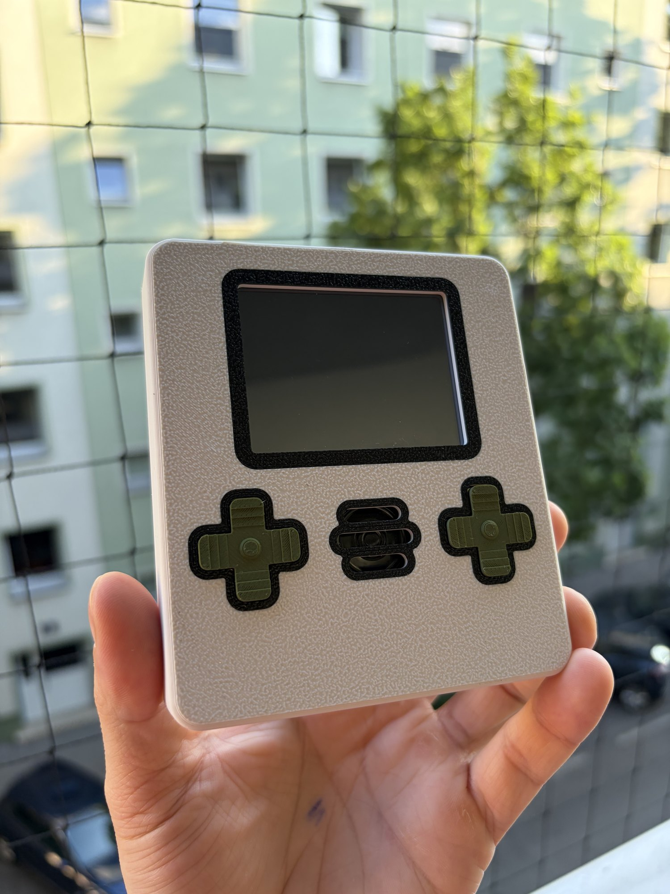
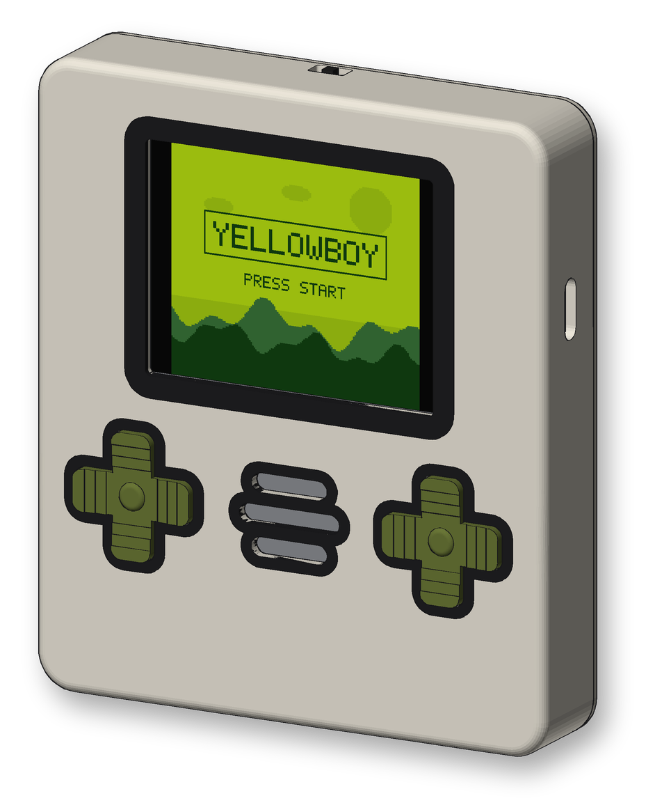
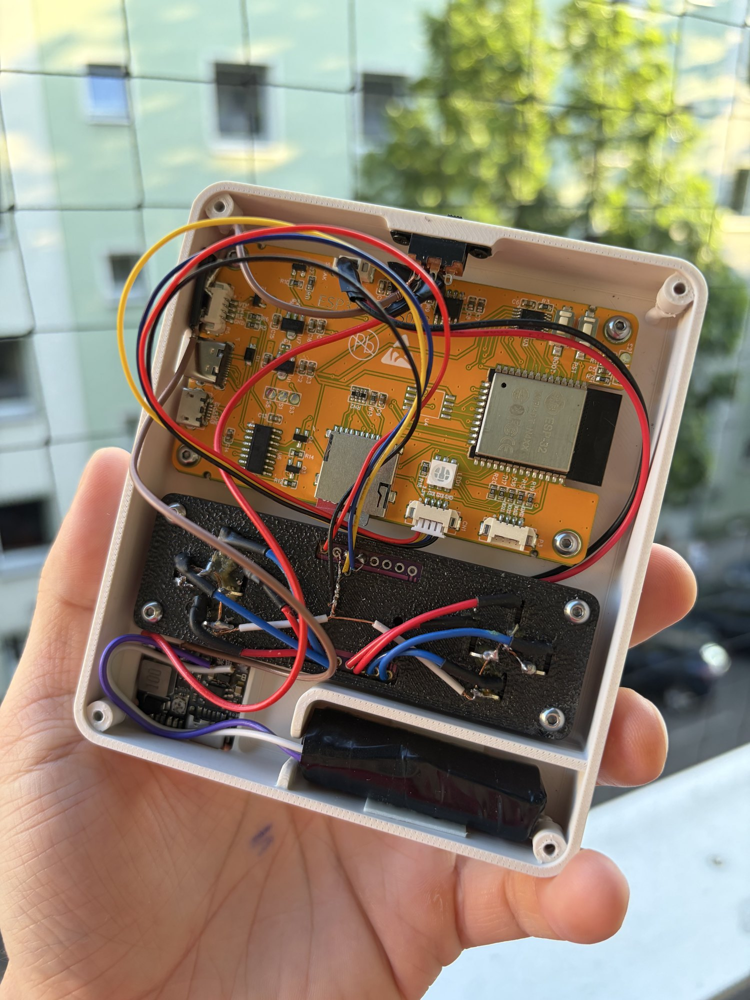
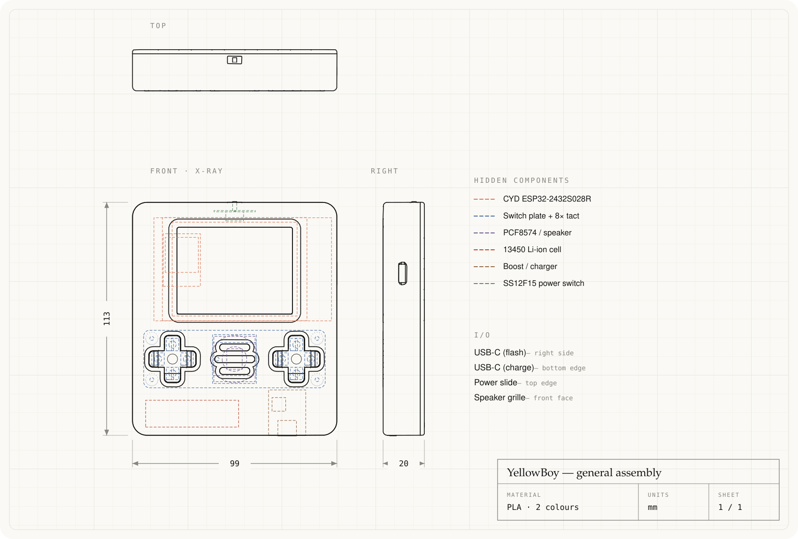
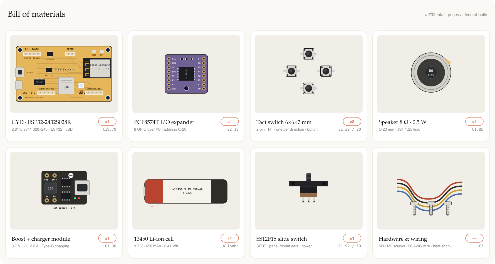
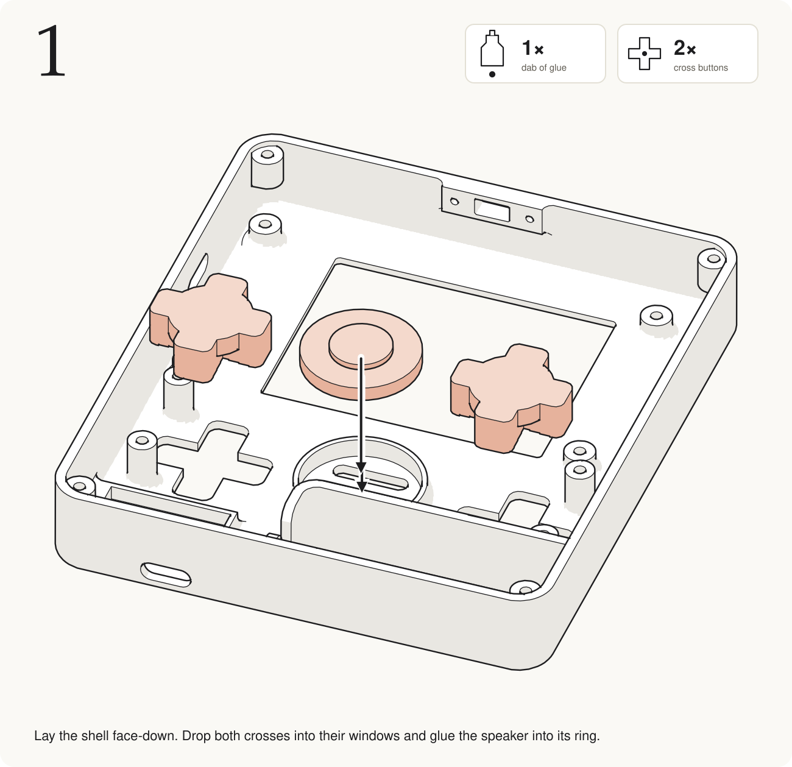
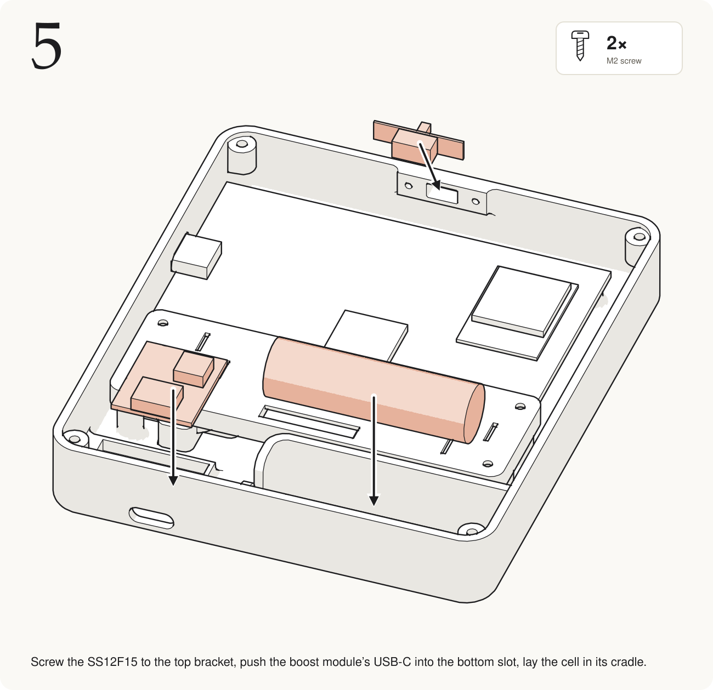
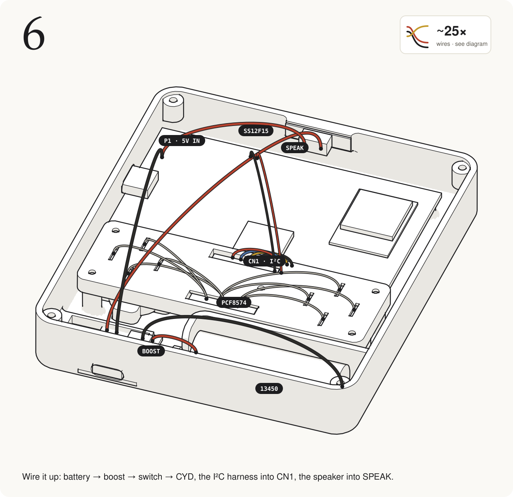
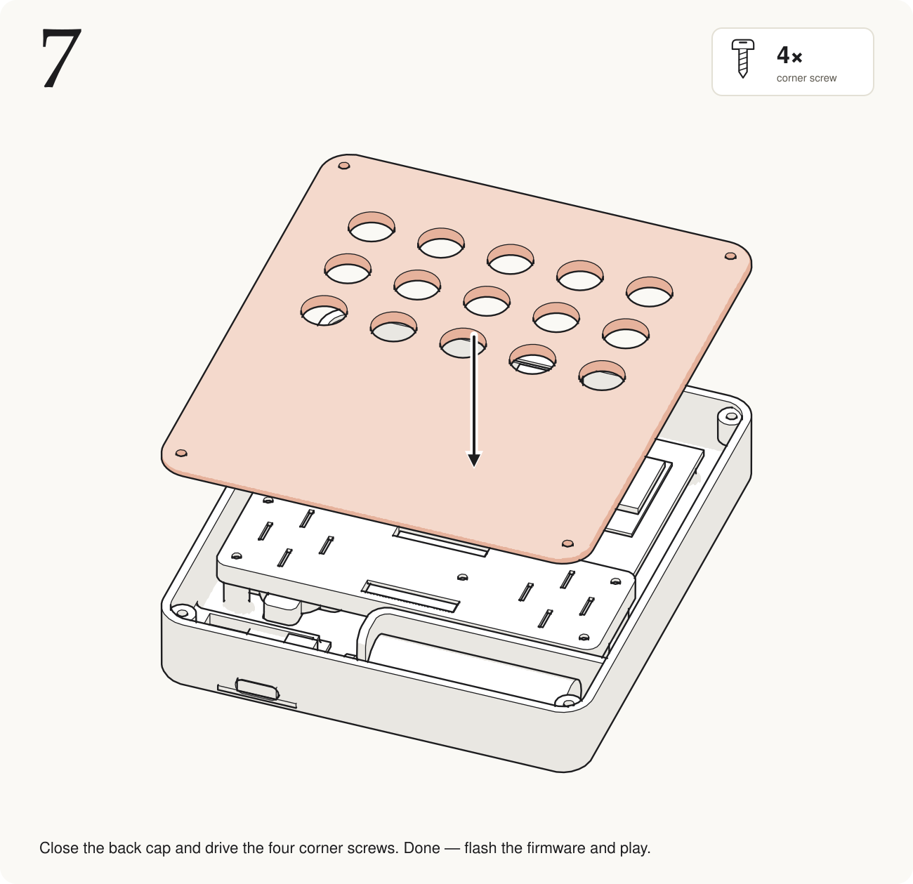

<p align="center">
  
</p>

<p align="center">
  
  
  
  
  
</p>

<p align="center">
  <a href="#hardware">Hardware</a> ·
  <a href="#build-guide">Build guide</a> ·
  <a href="#software">Software</a> ·
  <a href="#roadmap">Roadmap</a>
</p>

---

**YellowBoy** is an open-source handheld game console built around the ESP32-2432S028R, the *Cheap Yellow Display* (CYD). Its core is the hardware:

* a two-colour 3D-printed shell
* two cross pads read through a single I²C expander
* a speaker driven by the ESP32's DAC
* a rechargeable Li-ion cell with USB-C charging

Everything is built from off-the-shelf modules, eight tact switches and some wire. There is no custom PCB.

The first software for the console is a **Game Boy emulator port**, so YellowBoy already plays Game Boy games. A **custom launcher** and a **game engine** written for the console are in development, and more emulator ports are planned.

<p align="center">
  
  
  
</p>

## At a glance

| | |
|---|---|
| **Processor** | ESP32-WROOM-32, dual-core Xtensa LX6 at 240 MHz, 520 KB SRAM, 4 MB flash, no PSRAM |
| **Display** | 2.8″ ILI9341 TFT, 320 × 240, 80 MHz SPI with DMA, PWM backlight |
| **Input** | D-pad and a four-button action pad: 8 tact switches on a PCF8574 I²C expander |
| **Audio** | ESP32 DAC (GPIO26) into the CYD's on-board amplifier and an 8 Ω, 0.5 W speaker |
| **Storage** | microSD (FAT32), plus internal flash and NVS for settings |
| **Power** | 13450 Li-ion cell (3.7 V, 650 mAh), boosted to 5 V, USB-C charging, slide power switch |
| **Ports** | USB-C for flashing (right side), USB-C for charging (bottom edge) |
| **Enclosure** | 4 printed parts (PLA, two colours), 99 × 113 × 20 mm |

## Roadmap

| | Status |
|---|---|
| Hardware v1: shell, controller, audio, power | Built |
| Game Boy emulator port | Playable |
| Custom launcher | In development |
| Game engine for YellowBoy | In development |
| More emulator ports | Planned |

> [!NOTE]
> YellowBoy is a work in progress. A build video will be published on YouTube.

---

# Hardware

<p align="center">
  
</p>

The stack, front to back:

* the **crosses** rock on centre pivots in the face
* the **speaker** sits in the ring behind the grille
* the **CYD** goes screen-first into the window on four bosses
* the **switch plate** clamps the crosses so each arm presses one tact switch
* the **cell**, **boost module** and **slide switch** fill the bottom and top edges
* the **back cap** closes it all

<details>
<summary><b>Technical drawing</b>: dimensions and hidden components</summary>
<br/>
<p align="center">
  
</p>
</details>

## Components

<p align="center">
  
</p>

| # | Part | Qty | Notes |
|---|------|:---:|-------|
| 1 | **ESP32-2432S028R** “Cheap Yellow Display” | 1 | 2.8″ ILI9341 320×240, ESP32-WROOM-32, µSD slot, on-board speaker amplifier |
| 2 | **PCF8574T** I/O expander module | 1 | The purple 16-pin breakout. Tie **A0–A2 to GND** for address `0x20` |
| 3 | **Tact switch 6 × 6 × 7 mm**, 2-pin THT | 8 | Four per cross pad |
| 4 | **Speaker 8 Ω 0.5 W, Ø 23 mm** with JST 1.25 lead | 1 | Plugs straight into the CYD's `SPEAK` header |
| 5 | **3.7 V → 5 V 2 A boost + charger**, Type-C | 1 | ⚠️ This module can also output 9 V. **Set it to 5 V.** |
| 6 | **13450 Li-ion cell**, 3.7 V 650 mAh | 1 | About 2.4 Wh |
| 7 | **SS12F15 SPDT slide switch**, panel-mount | 1 | Power switch on the top edge |
| 8 | Hardware | – | 4 × M3 for the CYD, 4 × M3 for the switch plate, 2 small screws for the slide switch, 4 corner screws for the back cap, 28 AWG wire, heat-shrink, a JST 1.25 4-pin cable |

> [!CAUTION]
> Li-ion cells can catch fire if they are shorted, punctured or over-discharged. Insulate every joint, keep the cell away from screw tips, and use a protected cell if you can.

## Printed parts

<p align="center">
  
</p>

All models are in [`hardware/stl`](hardware/stl). They are exported in their assembled positions, so you can load them into one scene to check fit.

| File | Part | Qty | Colour |
|------|------|:---:|--------|
| `Shell.stl` | Front shell (face, bosses, battery cradle, switch bracket, port cut-outs) | 1 | White |
| `Shell-Color.stl` | **Paint mask only**: screen bezel, cross outlines, speaker grille | – | Black |
| `cap.stl` | Back cap | 1 | White |
| `d-pad.stl` | Switch plate: holds the 8 tact switches and the PCF8574 | 1 | Black |
| `button.stl` | Cross button: one for the D-pad, one for the action pad | 2 | Olive |

> [!TIP]
> **Two-colour face:** `Shell-Color.stl` is not a separate part. It overlaps the shell on purpose. In Bambu Studio, OrcaSlicer or PrusaSlicer, load `Shell.stl`, add `Shell-Color.stl` to the same object as a *part* or *modifier*, and assign it the second filament. With a single-colour printer, skip it.

Suggested print settings: PLA, 0.2 mm layers, 3 walls, 15 % infill. Print the shell face-down so the textured face comes out clean.

## Wiring

<p align="center">
  
</p>

**Power.** The cell connects to the boost module's `B+`/`B−` pads. Its `OUT+` goes through the SS12F15 switch to `VIN` on the CYD's `P1` header, and `OUT−` goes to `GND` on `P1`. The switch is on the 5 V output side, so the cell keeps charging through the boost module's USB-C port while the console is off.

**Controller.** Plug a JST 1.25 4-pin cable into the CYD's `CN1` header and connect it to the PCF8574:

| CN1 pin | PCF8574 pin |
|---------|-------------|
| `3V3`   | `VCC` |
| `IO27`  | `SCL` |
| `IO22`  | `SDA` |
| `GND`   | `GND` (the module's `A0`–`A2` are bridged to `GND`) |

Wire one leg of each tact switch to a P-pin and the other leg to a shared ground. Buttons are active-low, and the PCF8574 provides the pull-ups, so you don't need resistors. The default pin map is in the diagram. Any order works, because the firmware learns your wiring on first boot.

**Audio.** Plug the speaker into the CYD's `SPEAK` header.

### GPIO map

| Function | GPIO |
|----------|------|
| TFT (HSPI): MOSI / MISO / SCLK / CS / DC / backlight | 13 / 12 / 14 / 15 / 2 / 21 |
| µSD (VSPI): MOSI / MISO / SCK / CS | 23 / 19 / 18 / 5 |
| Controller (I²C to PCF8574 @ `0x20`): SDA / SCL | 22 / 27 |
| Audio (DAC2) | 26 |
| RGB LED: R / G / B | 4 / 16 / 17 |

---

# Build guide

Work from the back, with the shell face-down on the table.

| | |
|:---:|:---:|
|  |  |
| **1** Drop both crosses into their windows. Glue the speaker into its ring. | **2** Press the 8 tact switches into the plate. Seat the PCF8574 in the centre recess and solder the switches. |
|  |  |
| **3** Screw the plate onto its four bosses. It holds the crosses in place. | **4** Fit the CYD screen-first, with the USB-C port toward the side slot. Fix it with 4 screws. |
|  |  |
| **5** Mount the slide switch, the boost module (USB-C into the bottom slot) and the cell. | **6** Wire everything as in the [wiring diagram](#wiring). |
|  |  |
| **7** Close the back cap with the four corner screws. Then [flash the firmware](#flash). | The finished interior, cap removed. |

---

# Software

YellowBoy's first firmware is a Game Boy emulator, and it is what this repository builds today. The launcher and game engine will live alongside it.

## Game Boy emulator

The emulator is a port of [Peanut-GB](https://github.com/deltabeard/Peanut-GB), tuned for the CYD:

- **Full-speed DMG emulation.** The emulator core runs on core 1. Rendering, input and audio run as FreeRTOS tasks on core 0.
- **No PSRAM.** A ROM is copied once into a 2.6 MB flash partition and memory-mapped, so the CPU reads the cartridge straight from flash.
- **Clean audio.** Samples from [minigb_apu](https://github.com/YigitSalihEmecen/minigb_apu_YellowBoy) go through a low-pass and DC-blocking filter. A 32 768 Hz timer interrupt then writes them to the DAC, so there is no PWM hiss.
- **Saves and settings.** Battery saves go to the SD card. Palette, frame-skip, brightness, volume and button map are stored in flash.
- **20 palettes.** Classic Green, Original DMG, Pocket Gray, Warm Sepia, Cool Blue, Autumn, Grayscale, Lava, Ocean, Forest, Sunset, Cherry, Ice, Chocolate, Mint, Peach, Lavender, Neon, Inverted, Gold.

<p align="center">
  
</p>

### Flash

1. Install [PlatformIO](https://platformio.org/) (CLI or the VS Code extension).
2. Connect the console with the USB-C port on its right side and run:

```bash
pio run -e cyd -t upload
```

3. Optionally, open the serial monitor to see FPS and debug output:

```bash
pio device monitor -b 115200
```

`platformio.ini` sets the pins and SPI clocks, and `partitions.csv` defines the 2.6 MB `rom` partition.

### SD card

Format a microSD card as **FAT32**. The firmware creates these folders on first boot:

```
/
├── roms/
│   ├── gb/      ← .gb files
│   └── gbc/     ← .gbc files (titles that also run on the original Game Boy play in DMG mode)
└── saves/       ← <rom>.sav, written by "Save Game"
```

### First boot

The console asks you to press **UP, DOWN, LEFT, RIGHT, A, B, START, SELECT** in that order. It stores the mapping in flash, along with default settings.

### Controls

| Where | Input | Action |
|-------|-------|--------|
| ROM list | UP / DOWN | Move the selection |
| ROM list | LEFT / RIGHT | Change page |
| ROM list | A | Start the game |
| In game | **START + SELECT** | Pause menu: Resume · Save Game · Load Save · Settings · Quit |
| Settings | LEFT / RIGHT | Change palette, frame-skip, brightness or volume |

The first time you load a ROM it is copied into flash, which takes a few seconds. On later loads, the firmware sees the same ROM is already there and skips the copy.

### Tested games

Super Mario Land · Super Mario Land 2: 6 Golden Coins · Batman: The Animated Series · Castlevania Legends · Tetris · Tetris 2 · Donkey Kong Land 2 · Donkey Kong Land 3 · The Legend of Zelda: Link's Awakening · Final Fantasy Adventure · Metroid II: Return of Samus

## Developing for YellowBoy

The hardware drivers in this repository can serve as a starting point for other firmware:

* `src/display`: DMA renderer for the ILI9341
* `src/input`: PCF8574 controller polling, with the button map stored in NVS
* `src/sd`: SD card file access

The [GPIO map](#gpio-map) lists every pin the console uses.

---

## Repository layout

```
YellowBoy/
├── hardware/stl/    printable models (assembled positions)
├── src/
│   ├── core/        main.cpp: setup, launcher loop, emulation loop · config.h: pins
│   ├── display/     ILI9341 DMA renderer (core 0)
│   ├── input/       PCF8574 polling, button map, NVS settings
│   ├── sd/          ROM scanning, save files
│   ├── emulator/    Peanut-GB bridge, ROM flash-mapping, audio pipeline
│   └── ui/          ROM list, pause menu, settings, mapping wizard
├── assets/          README visuals (SVG and renders)
├── tools/render/    Python scripts that generate every visual from the STLs
├── images/          photos of the build
├── partitions.csv   flash layout, including the 2.6 MB ROM partition
└── platformio.ini
```

<details>
<summary><b>Regenerating the visuals</b></summary>
<br/>

The exploded view, build guide, technical drawing and renders are not hand-drawn. `tools/render` builds them from the STLs with a small NumPy rasteriser and a hidden-line extractor. The off-the-shelf modules are modelled as simple solids and placed on the shell's real bosses and cut-outs. After changing the case, run:

```bash
pip install numpy scipy matplotlib pillow
./tools/render/build.sh   # writes tools/render/out/
```
</details>

## Credits

- [Peanut-GB](https://github.com/deltabeard/Peanut-GB) by deltabeard: the Game Boy emulator core
- [minigb_apu](https://github.com/deltabeard/minigb_apu) by deltabeard: the Game Boy audio unit ([YellowBoy fork](https://github.com/YigitSalihEmecen/minigb_apu_YellowBoy))
- [TFT_eSPI](https://github.com/Bodmer/TFT_eSPI) by Bodmer: the display driver

## License

[MIT](LICENSE) © 2026 Yigit Salih Emecen. Game Boy is a trademark of Nintendo. This project contains no Nintendo code or ROMs. Use only games you own.
